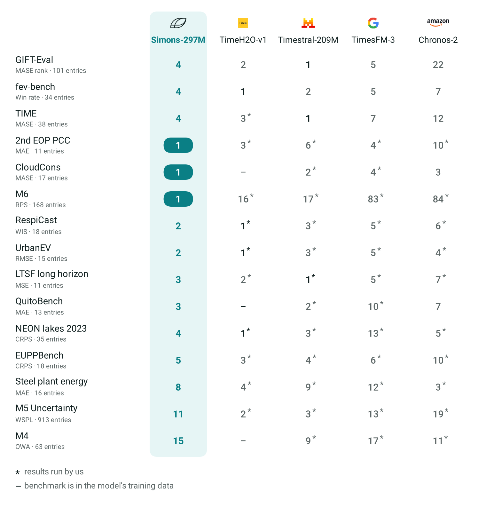
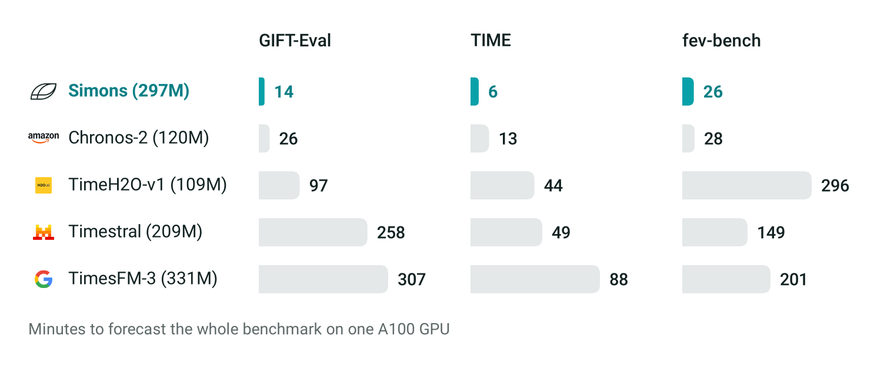

# Simons

<table>
  <tr>
    <td><b>Package</b></td>
    <td><a href="https://pypi.org/project/simons-forecasting/"></a> <a href="https://github.com/Abel-ai-lab/Simons/blob/main/pyproject.toml"></a> <a href="https://github.com/Abel-ai-lab/Simons/releases"></a> <a href="https://github.com/Abel-ai-lab/Simons/blob/main/LICENSE"></a></td>
  </tr>
  <tr>
    <td><b>Weights and Data</b></td>
    <td><a href="https://huggingface.co/collections/abel-lab/simons-1-6ae3d4ce9705938e293c52dd"></a> <a href="https://huggingface.co/datasets/abel-lab/Simons-Pretrain"></a> <a href="https://huggingface.co/abel-lab/Simons-297M/blob/main/LICENSE"></a></td>
  </tr>
  <tr>
    <td><b>Benchmarks</b></td>
    <td><a href="https://paperswithcode.co/api/v1/papers/133409/leaderboard-badge-link?eval=49305"></a> <a href="https://paperswithcode.co/api/v1/papers/133409/leaderboard-badge-link?eval=49311"></a> <a href="https://paperswithcode.co/api/v1/papers/133409/leaderboard-badge-link?eval=49306"></a></td>
  </tr>
  <tr>
    <td><b>Integrations</b></td>
    <td><a href="https://github.com/TimeCopilot/foundationforecast"></a> <a href="https://github.com/Abel-ai-lab/Simons/blob/main/docs/GETTING_STARTED.md#options"></a></td>
  </tr>
  <tr>
    <td><b>Read more</b></td>
    <td><a href="https://abel.ai/research/introducing-simons/"></a> <a href="https://github.com/Abel-ai-lab/nanoTSFM"></a></td>
  </tr>
</table>

**Simons** is a family of four open time series foundation models developed by Abel AI Lab for zero-shot probabilistic forecasting. Starting from a 3.3M-parameter [baseline](https://github.com/Abel-ai-lab/nanoTSFM), we developed the models in just 15 days, achieving SOTA performance on several benchmark datasets.


<picture>
  <source media="(prefers-color-scheme: dark)" srcset="https://raw.githubusercontent.com/Abel-ai-lab/Simons/main/docs/assets/benchmark-places-dark.png">
  
</picture>

Simons is also very fast. It can complete a GIFT-Eval benchmark run in just 14 minutes on a single A100 GPU.

<picture>
  <source media="(prefers-color-scheme: dark)" srcset="https://raw.githubusercontent.com/Abel-ai-lab/Simons/main/docs/assets/inference-time-dark.png">
  
</picture>

## Open Artifacts

Simons is fully open source. In addition to the inference code and model weights, we release the complete training recipe and code.

| Artifact | Type | Source |
|---|---|---|
| Simons-25M | Model weights | [abel-lab/Simons-25M](https://huggingface.co/abel-lab/Simons-25M) |
| Simons-60M | Model weights | [abel-lab/Simons-60M](https://huggingface.co/abel-lab/Simons-60M) |
| Simons-178M | Model weights | [abel-lab/Simons-178M](https://huggingface.co/abel-lab/Simons-178M) |
| Simons-297M | Model weights | [abel-lab/Simons-297M](https://huggingface.co/abel-lab/Simons-297M) |
| Simons-Pretrain | Pretraining data | [abel-lab/Simons-Pretrain](https://huggingface.co/datasets/abel-lab/Simons-Pretrain) |
| Code | Inference and training | [`src/simons`](https://github.com/Abel-ai-lab/Simons/tree/main/src/simons) |
| Training recipes | Configurations and scripts | [`configs/`](https://github.com/Abel-ai-lab/Simons/tree/main/configs), [`scripts/train.sh`](https://github.com/Abel-ai-lab/Simons/blob/main/scripts/train.sh) |
| Benchmark code | GIFT-Eval, fev-bench, TIME | [`benchmarks/`](https://github.com/Abel-ai-lab/Simons/tree/main/benchmarks) |
| Forecast Explorer | Forecasting demo | [abel-lab/simons-forecast-explorer](https://huggingface.co/spaces/abel-lab/simons-forecast-explorer) |

## Install

Simons requires Python 3.10+ and PyTorch 2.5+. A GPU is optional for inference.

```shell
pip install simons-forecasting
# or with uv
uv pip install simons-forecasting
```

## Forecast

```python
import torch
from simons import Simons

device = "cuda" if torch.cuda.is_available() else "cpu"
model = Simons.from_pretrained("abel-lab/Simons-60M", device=device)

history = torch.randn(8, 2000).cumsum(-1)         # [batch, time]; NaN marks missing values
quantiles = model.forecast(history, horizon=96)  # [batch, 96, 9]: quantiles 0.1 to 0.9

# Known-future covariates span the history and the horizon: [batch, covariates, time + horizon]
covariates = torch.randn(8, 2, 2000 + 96)
quantiles = model.forecast(history, horizon=96, covariates=covariates)
```

## Integrations

| Library | Use |
|---|---|
| [FoundationForecast](https://github.com/TimeCopilot/foundationforecast) (TimeCopilot) | `from foundationforecast.models import Simons` |
| [GluonTS](https://github.com/awslabs/gluonts) | `from simons.predictor import SimonsPredictor` |

## Train

```shell
git clone https://github.com/Abel-ai-lab/Simons && cd Simons && pip install -e ".[train]"
python scripts/prepare_example_data.py --output data/example
bash scripts/train.sh 25m data/example/train data/example/covariates
```

## Learn More

- [Getting started](https://github.com/Abel-ai-lab/Simons/blob/main/docs/GETTING_STARTED.md): input formats, covariates, forecasting options, and fine-tuning
- [Models](https://github.com/Abel-ai-lab/Simons/blob/main/docs/MODEL.md): the four sizes, their scores, CPU memory and time, and the benchmark runs
- [Training](https://github.com/Abel-ai-lab/Simons/blob/main/docs/TRAINING.md)
- [Training data](https://github.com/Abel-ai-lab/Simons/blob/main/docs/DATA.md)
- [examples/demo.ipynb](https://github.com/Abel-ai-lab/Simons/blob/main/examples/demo.ipynb): end-to-end forecasting on a CPU
- [examples/finetune.ipynb](https://github.com/Abel-ai-lab/Simons/blob/main/examples/finetune.ipynb)
- [Forecast Explorer](https://huggingface.co/spaces/abel-lab/simons-forecast-explorer): forecasts from all four models in your browser
- [CONTRIBUTING.md](https://github.com/Abel-ai-lab/Simons/blob/main/CONTRIBUTING.md)
- [CHANGELOG.md](https://github.com/Abel-ai-lab/Simons/blob/main/CHANGELOG.md)

## Citation

```bibtex
@misc{simons2026,
  title  = {Simons: Building Open Time Series Foundation Models through Auto-Research},
  author = {{Abel AI Lab}},
  year   = {2026},
  url    = {https://github.com/Abel-ai-lab/Simons}
}
```

## License

The code is licensed under [Apache-2.0](https://github.com/Abel-ai-lab/Simons/blob/main/LICENSE), and the model weights are licensed under [OpenMDW-1.1](https://huggingface.co/abel-lab/Simons-297M/blob/main/LICENSE).

The training datasets retain their respective licenses. The training data [NOTICE.md](https://huggingface.co/datasets/abel-lab/Simons-Pretrain/blob/main/NOTICE.md) lists the relevant licenses and attributions.
