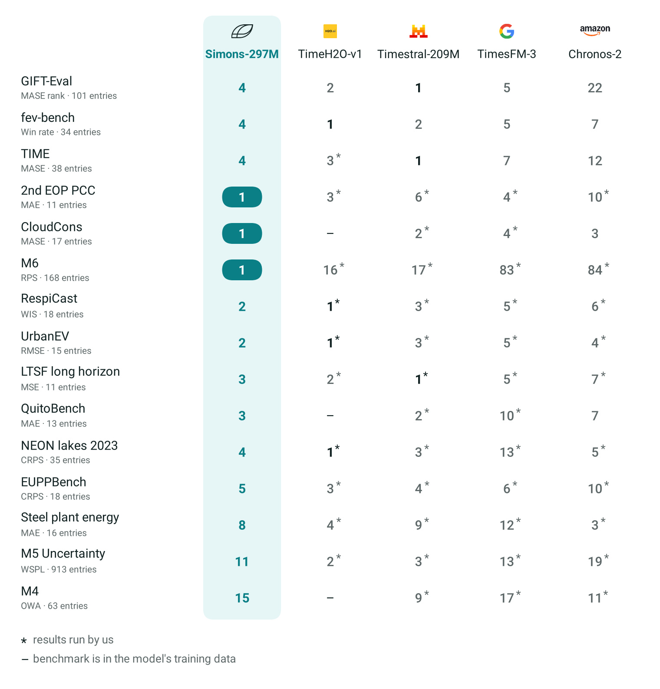
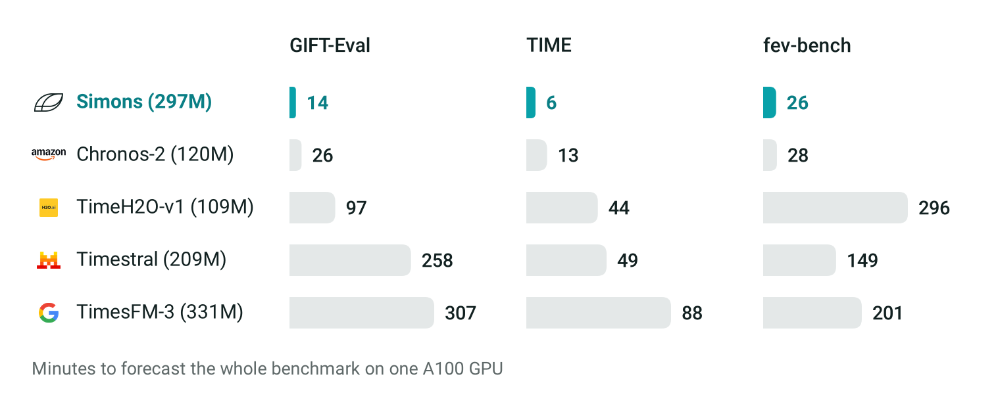

# Simons

[](https://huggingface.co/collections/abel-lab/simons-1-6ae3d4ce9705938e293c52dd)
[](https://abel.ai/research/introducing-simons/)
[](https://github.com/Abel-ai-lab/nanoTSFM)
[](pyproject.toml)
[](https://pytorch.org)
[](LICENSE)
[](https://huggingface.co/abel-lab/Simons-297M/blob/main/LICENSE)

**Simons** is a family of four open time series foundation models developed by Abel AI Lab for zero-shot probabilistic forecasting. Starting from a 3.3M-parameter [baseline](https://github.com/Abel-ai-lab/nanoTSFM), we developed the models in just 15 days, achieving state-of-the-art (SOTA) performance on several benchmark datasets.

<picture>
  <source media="(prefers-color-scheme: dark)" srcset="docs/assets/benchmark-places-dark.png">
  
</picture>

Simons is also very fast. It can complete a GIFT-Eval benchmark run in just 14 minutes on a single A100 GPU.

<picture>
  <source media="(prefers-color-scheme: dark)" srcset="docs/assets/inference-time-dark.png">
  
</picture>

## Open Artifacts

Simons is fully open source. In addition to the inference code and model weights, we release the complete training recipe and code.

| Artifact | Type | Source |
|---|---|---|
| Simons-25M | Model weights | [abel-lab/Simons-25M](https://huggingface.co/abel-lab/Simons-25M) |
| Simons-60M | Model weights | [abel-lab/Simons-60M](https://huggingface.co/abel-lab/Simons-60M) |
| Simons-178M | Model weights | [abel-lab/Simons-178M](https://huggingface.co/abel-lab/Simons-178M) |
| Simons-297M | Model weights | [abel-lab/Simons-297M](https://huggingface.co/abel-lab/Simons-297M) |
| Simons-Pretrain | Pretraining data | [abel-lab/Simons-Pretrain](https://huggingface.co/datasets/abel-lab/Simons-Pretrain) |
| Code | Inference and training | [`src/simons`](src/simons) |
| Training recipes | Configurations and scripts | [`configs/`](configs), [`scripts/train.sh`](scripts/train.sh) |
| Benchmark code | GIFT-Eval, fev-bench, TIME | [`benchmarks/`](benchmarks) |
| Forecast Explorer | Forecasting demo | [abel-lab/simons-forecast-explorer](https://huggingface.co/spaces/abel-lab/simons-forecast-explorer) |

## Install

Simons requires Python 3.10+ and PyTorch 2.5+. A GPU is optional for inference.

```shell
pip install "git+https://github.com/Abel-ai-lab/Simons"
# or with uv
uv pip install "git+https://github.com/Abel-ai-lab/Simons"
```

## Forecast

```python
import torch
from simons import Simons

device = "cuda" if torch.cuda.is_available() else "cpu"
model = Simons.from_pretrained("abel-lab/Simons-60M", device=device)

history = torch.randn(8, 2000).cumsum(-1)         # [batch, time]; NaN marks missing values
quantiles = model.forecast(history, horizon=96)  # [batch, 96, 9]: quantiles 0.1 to 0.9

# Known-future covariates span the history and the horizon: [batch, covariates, time + horizon]
covariates = torch.randn(8, 2, 2000 + 96)
quantiles = model.forecast(history, horizon=96, covariates=covariates)
```

## Train

```shell
git clone https://github.com/Abel-ai-lab/Simons && cd Simons && pip install -e .
python scripts/prepare_example_data.py --output data/example
bash scripts/train.sh 25m data/example/train data/example/covariates
```

## Learn More

| | |
|---|---|
| [Introducing Simons](https://abel.ai/research/introducing-simons/) | The release post: what Simons is and how it performs |
| [Getting started](docs/GETTING_STARTED.md) | Input formats, covariates, forecasting options, and fine-tuning |
| [Models](docs/MODEL.md) | The four model sizes, scores, and benchmark runs |
| [Training](docs/TRAINING.md) | Training stages, configurations, GPU and memory settings, and corpus formats |
| [Training data](docs/DATA.md) | Training data, including the public [Simons-Pretrain](https://huggingface.co/datasets/abel-lab/Simons-Pretrain) dataset |
| [examples/demo.ipynb](examples/demo.ipynb) | End-to-end forecasting on a CPU |
| [examples/finetune.ipynb](examples/finetune.ipynb) | Fine-tuning a released model on your data |
| [Forecast Explorer](https://huggingface.co/spaces/abel-lab/simons-forecast-explorer) | Explore forecasts from all four models in your browser |
| [CONTRIBUTING.md](CONTRIBUTING.md) | Tests, code style, and pull requests |

## Citation

```bibtex
@misc{simons2026,
  title  = {Simons: Building Open Time Series Foundation Models through Auto-Research},
  author = {{Abel AI Lab}},
  year   = {2026},
  url    = {https://github.com/Abel-ai-lab/Simons}
}
```

## License

The code is licensed under [Apache-2.0](LICENSE), and the model weights are licensed under OpenMDW-1.1.

The training datasets retain their respective licenses. The training data [NOTICE.md](https://huggingface.co/datasets/abel-lab/Simons-Pretrain/blob/main/NOTICE.md) lists the relevant licenses and attributions.
